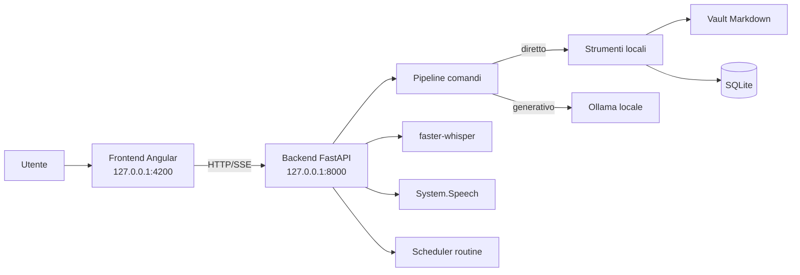

# Architettura JARVIS

Documento aggiornato allo stato implementato. Per avvio e uso quotidiano vedi `README.md`.

## Componenti

## Pipeline

1. **Diretto**: parser italiano → strumento del registro chiuso → risposta (nessun modello).
2. **Modello locale**: Ollama `llama3.2:3b` con prompt compatto, cronologia limitata, estratti memoria budgetati, streaming SSE, timeout e coda.
3. **Offline modello**: note/attività/agenda/promemoria/strumenti restano attivi; le funzioni generative segnalano indisponibilità senza simulare successo.

## Dati

| Tipo | Dove |
| --- | --- |
| Memoria (Obsidian) | `backend/vault/` — `raw/`, `wiki/`, `outputs/` (Markdown + wikilink `[[…]]`) |
| Preferenze | `backend/vault/wiki/preferences.md` |
| Attività, eventi, promemoria, metriche, indice note, log, routine | `backend/data/jarvis.db` (indice ricostruibile; la fonte di verità delle note resta il vault) |
| App consentite | `backend/config/apps.json` |
| Routine | `backend/config/routines.json` |

## Sicurezza

Registro strumenti chiuso, validazione argomenti, percorsi confinati al vault, ascolto solo locale, CORS ristretto, niente shell/`eval` dal modello, integrazioni assenti marcate `non_configurato`.

## Limiti noti

- Inferenza su CPU (Iris Xe senza CUDA): ~15–16 tok/s.
- STT richiede download iniziale del modello Whisper.
- Routine attive solo a processo avviato.
- Hotword «Jarvis» non abilitata (push-to-talk sì).
